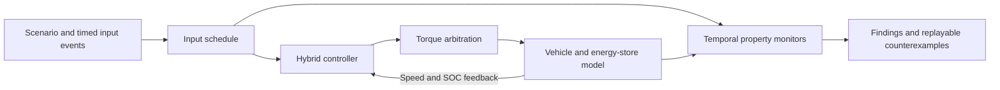

# TorqueGuard

### Hybrid Power Unit State-Space Validator

TorqueGuard is a simulation and verification laboratory for hybrid powertrain control software. It investigates whether interactions between energy recovery, deployment restrictions and driver inputs can leave a vehicle unable to produce propulsion torque when physical capacity is available.

The application combines a stateful controller, a longitudinal vehicle model and temporal property monitors. Engineers can build an operating scenario, change its inputs over time, compare controller policies and inspect the trajectory that caused a requirement to fail.

## Engineering problem

A hybrid power unit must arbitrate between combustion torque, electrical deployment and energy recovery while respecting operating limits. A decision that is valid in one mode can become problematic when the vehicle slows, a sector restriction changes or the driver requests acceleration. Those interactions depend on the preceding sequence of states as well as the current sensor values.

TorqueGuard investigates **torque starvation**: sustained driver demand that fails to produce sufficient drive-axle torque despite available energy, an engaged clutch and an adequate grip envelope. It distinguishes that condition from legitimate inhibitions such as braking, an open clutch or unavailable propulsion capacity.

The project was motivated by the October 2026 Bahrain Grand Prix in Malaysia power-loss incident. The [FIA investigation](https://api.fia.com/news/fia-concludes-investigation-bahrain-gp-malaysia-formation-lap-software-bug) identifies low engine RPM and restricted circuit sectors as contributing conditions. TorqueGuard uses a documented synthetic fault to explore this class of control failure; its controller is an independent engineering model.

## Simulation architecture

The plant advances at a fixed **20 ms** interval. The injected-fault and corrected controllers each run with an independent vehicle and battery trajectory under the same external input schedule. This allows a control decision to affect subsequent speed, energy availability and reachable controller states.

| Layer | Responsibility |
| --- | --- |
| Scenario and event schedule | Initial conditions, base driver schedule and persistent changes to external inputs |
| Controller | Mode transitions, driver-demand arbitration and electrical availability |
| Torque arbitration | ICE and MGU-K axle torque, deployment caps and grip constraints |
| Plant | Vehicle acceleration, signed electrical power and SOC integration |
| Monitors | Continuous response timing and per-step operating invariants |
| Validation campaign | Seeded trajectory generation, paired comparison and counterexample retention |
| Telemetry interface | Input editing, event markers, trace scrubbing and evidence export |

## Temporal scenario exploration

The event timeline changes individual signals at specified simulation times. Supported signals include throttle, brake, wet-weather mode, sector ID, sector restriction, deployment power cap, grip, clutch engagement and engine availability.

Events at the same time are applied atomically. A change persists until a later event updates that signal. Unchanged signals retain the base scenario schedule. Vehicle speed and SOC remain continuous plant state, so a sector transition cannot silently reset the vehicle or its energy history.

For example, the **wet entry and sector release** scenario explores this sequence:

| Time | External event | Question being investigated |
| --- | --- | --- |
| 1.00 s | Wet mode activates in a restricted sector | Can low-speed recovery enter an unrecoverable controller state? |
| 2.00 s | Driver requests acceleration | Does available propulsion return within the response deadline? |
| 3.00 s | Throttle is released | Does the response monitor reset when demand ends? |
| 3.30 s | Throttle is reapplied | Does the controller retain the problematic state? |
| 4.00 s | Vehicle enters an unrestricted sector | Can the controller recover when the external restriction clears? |

Additional presets investigate rain onset after a dry restart, delayed clutch engagement and an SOC reserve crossing combined with changing electrical caps. The SOC crossing emerges from energy integration rather than a scripted SOC assignment.

## Controller behavior

The control model exposes six modes: `COAST`, `RECOVERY`, `WET_HOLD`, `DEPLOY`, `ICE_ONLY` and `INHIBITED`.

The injected fault enters `WET_HOLD` when braking at very low speed and low RPM under wet sector restrictions. Its exit guard requires a higher vehicle speed while its torque arbitration prevents the vehicle from accelerating to that speed. Removing the wet or sector restriction can release the latch; a failure already observed remains in the validation report.

The corrected policy evaluates brake and clutch conditions, releases recovery on a valid propulsion request and retains the deployment cap and SOC reserve. ICE-only propulsion remains available when the modeled electrical energy cannot be deployed.

The exact entry and exit thresholds, torque arbitration and corrected policy are model assumptions. They do not represent disclosed FIA ECU source code or the implementation of the race configuration update.

## Verification properties

| Property | Requirement |
| --- | --- |
| `TORQUE_LIVENESS` | With throttle ≥70%, brake <5%, an engaged clutch and independently calculated available axle torque >150 Nm, wheel torque must not remain below 100 Nm for 0.50 s. |
| `DEPLOYMENT_LIMIT` | Positive MGU-K mechanical wheel power must remain within the active deployment cap, including after a timed cap change. |
| `SOC_BOUNDS` | Energy-store SOC must remain within [0, 1]. |
| `BRAKE_PRIORITY` | A braking request must not produce positive drive-axle torque. |

The liveness monitor requires continuous eligible demand. Throttle withdrawal, braking or clutch disengagement resets its timer. Availability is calculated from physical and operating inputs independently of the controller's output, allowing a blocked controller to be detected without treating legitimate power restrictions as failures.

## Model physics

The longitudinal plant includes combined ICE and MGU-K axle torque, a simplified grip envelope, braking force, rolling and aerodynamic resistance, vehicle acceleration and battery energy accounting.

MGU-K power is calculated from axle torque and wheel angular velocity:

\[
P_K = T_K\omega_w
\]

Positive power represents deployment; negative power represents harvesting. Available battery energy and charging headroom constrain electrical torque before SOC is integrated. The near-zero-speed torque saturation remains finite, while wheel power is zero at standstill.

The reference model uses illustrative parameters including an 800 kg vehicle mass, a 0.33 m wheel radius, fixed gearing and a 4 MJ energy store. Equations, units, thresholds and modeling choices are documented in the [modeling contract](docs/model.md).

## Campaigns and engineering evidence

TorqueGuard provides two reproducible search profiles:

- **Boundary conditions:** samples speed, SOC, grip, throttle and power-limit boundaries alongside operating flags.
- **Temporal event sequences:** explores wet-sector entry, early and delayed restriction release, throttle interruption, clutch engagement and persistent restrictions.

Reports preserve the seed, model version, profile, scheduled event count, observed states and transitions, violation details and the full scenario for the first counterexample. A witness can be replayed independently of the rest of the search. JSON preserves the experiment definition; CSV exposes the paired per-step telemetry for further analysis.

Campaigns are sampled trajectory searches. Observed state and condition counts describe the exercised envelope and do not establish exhaustive coverage of continuous states or all possible event orders. The [verification record](docs/verification.md) keeps results associated with their model version and search profile.

## Scope and development direction

TorqueGuard currently supports software-in-the-loop investigation using an illustrative plant and controller. Sector IDs and restrictions are scheduled inputs; the model does not yet derive track position from circuit geometry. Detailed tyre behavior, clutch slip, gear changes, thermal and voltage limits, measured engine maps and complete FIA energy-per-lap counters remain outside the model.

Further development focuses on counterexample minimization, multiple fault hypotheses, requirements-to-test traceability and adapters for externally implemented controllers. These additions would extend the application from demonstrating one control failure mechanism to evaluating a broader set of hybrid control implementations.

## Project documentation

- [Operating guide](docs/operating-guide.md) — local execution, campaign commands, report replay and event input format.
- [Modeling contract](docs/model.md) — units, equations, event semantics and verification assumptions.
- [Verification record](docs/verification.md) — automated checks and recorded campaign results.
- [Incident analysis](docs/incident-analysis.md) — source evidence and the boundary between reported facts and model hypotheses.
